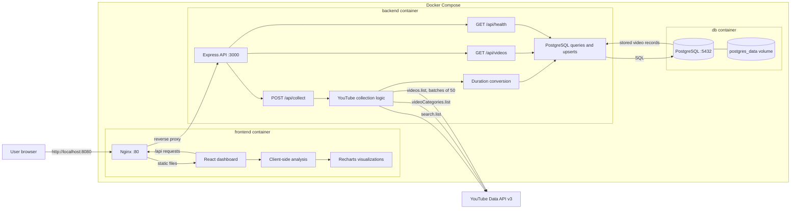
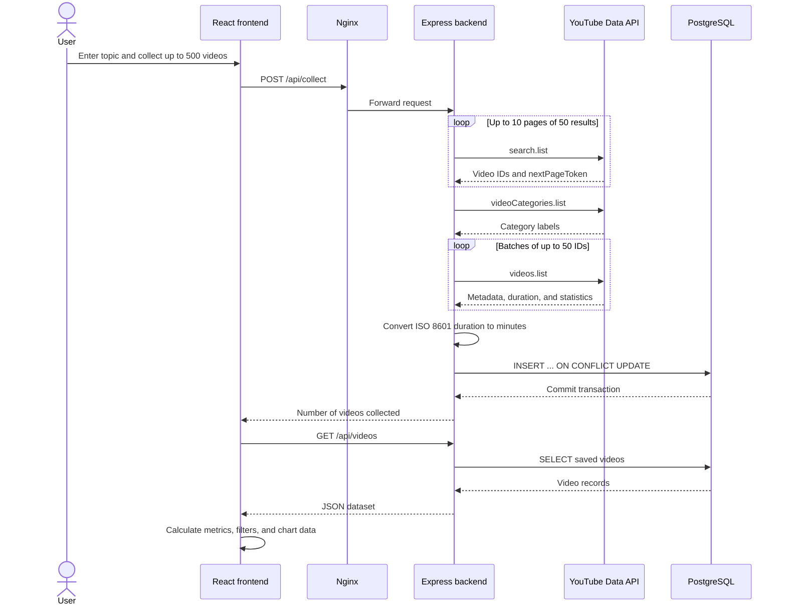
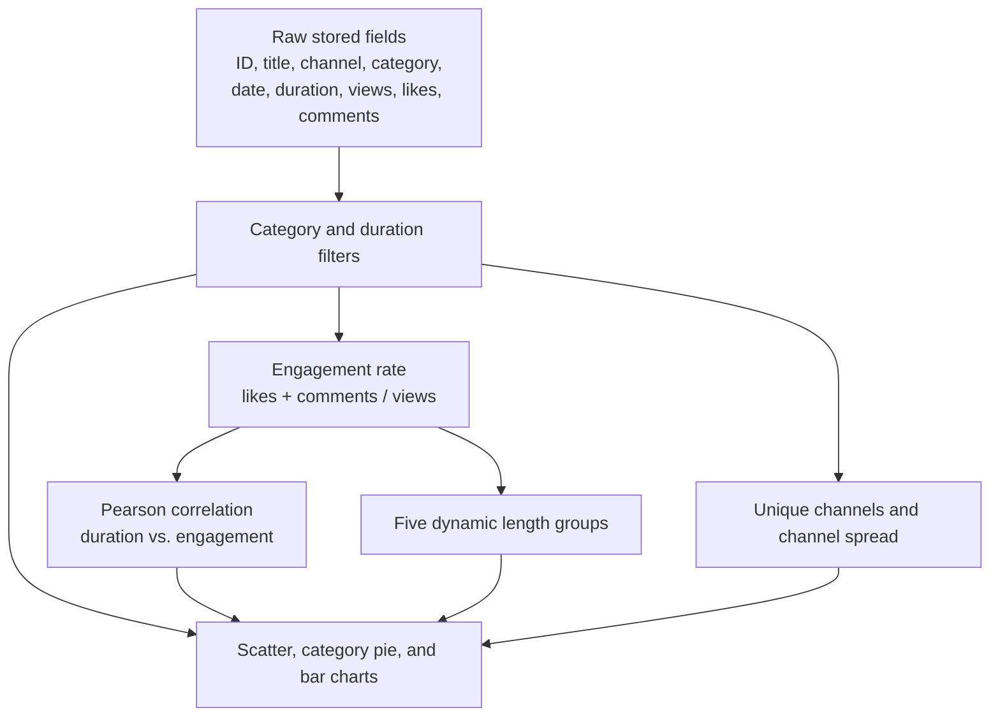

# EduTube Analytics architecture

## System architecture

## Collection request flow

## Routes and external endpoints

| Method | Route or endpoint | Purpose |
| --- | --- | --- |
| `GET` | `/api/health` | Confirms that the backend can connect to PostgreSQL. |
| `GET` | `/api/videos` | Returns all stored videos, ordered by view count. |
| `POST` | `/api/collect` | Accepts a topic and count, collects YouTube data, and upserts it into PostgreSQL. |
| `GET` | YouTube `search.list` | Finds video IDs using paginated search requests. |
| `GET` | YouTube `videoCategories.list` | Resolves YouTube category IDs to readable category names. |
| `GET` | YouTube `videos.list` | Retrieves metadata, ISO 8601 duration, views, likes, and comments in batches of 50. |

## Data and analysis boundary

The backend collects and stores raw data. The React frontend performs the current filtering and statistical analysis after loading the dataset from `GET /api/videos`.
